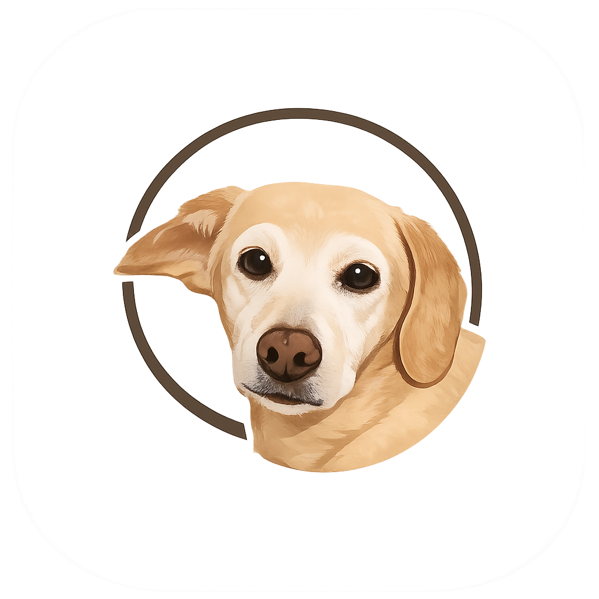
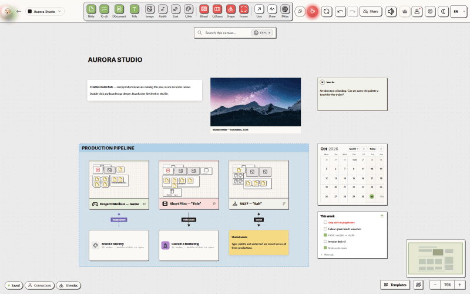
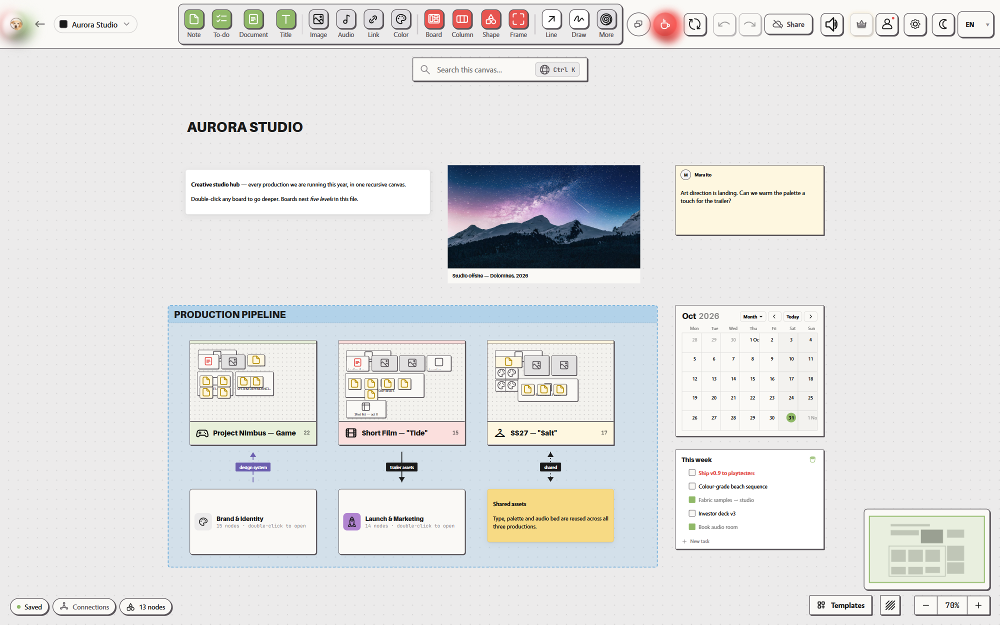
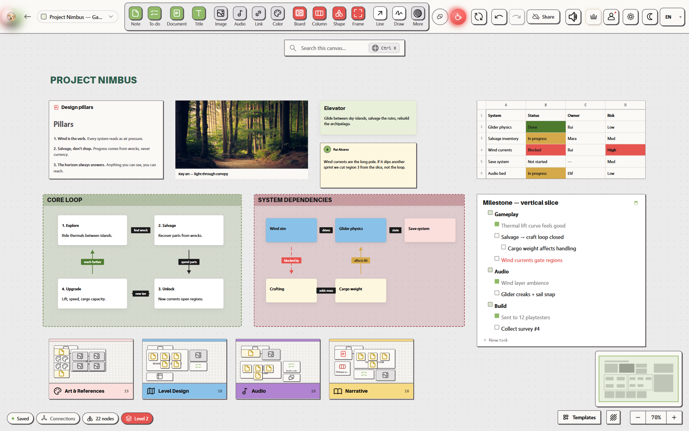
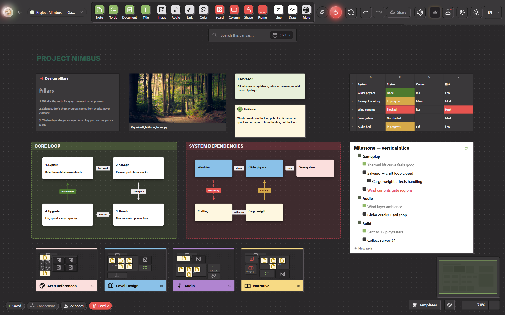

<div align="center">



# Oddinote

**A free, open-source infinite canvas for people whose ideas don't fit on one screen.**

Nested boards, unlimited notes, offline-first. A [Milanote](https://oddinote-web.vercel.app/milanote-alternative.html) and [Miro](https://oddinote-web.vercel.app/miro-alternative.html) alternative with no card limit and no subscription.

[**▶ Try it in your browser**](https://oddinote-web.vercel.app/#try-web) · [**⬇ Download**](https://oddinote-web.vercel.app/#download) · [**📖 User guide**](https://oddinote-web.vercel.app/guide.html) · [**🌐 Website**](https://oddinote-web.vercel.app)


</div>

<p align="center">
  
</p>

<table>
  <tr>
    <td width="33%"></td>
    <td width="33%"></td>
    <td width="33%"></td>
  </tr>
  <tr>
    <td align="center"><sub>A whole studio on one canvas</sub></td>
    <td align="center"><sub>Double-click a board to go inside</sub></td>
    <td align="center"><sub>Dark mode</sub></td>
  </tr>
</table>

---

## Why Oddinote exists

Visual canvas tools are wonderful for planning games, novels and creative projects — but the popular ones cap how much you can create (Milanote stops at 100 notes, Miro at 3 editable boards), lock the useful parts behind subscriptions, or keep your work in their cloud.

Oddinote was built by one developer who kept hitting those ceilings while organising game design documents, art references and task boards. It has the same spatial feel, none of the limits, and your files stay on your machine.

## What makes it different: real recursion

A board in Oddinote isn't a folder — it's a **complete canvas**, and any canvas inside it can hold more boards, forever.

```
Root canvas — pitch, core loop, roadmap
└── Art board
    └── Characters board
        └── Mood board per character  →  and deeper, as far as you need
```

Breadcrumbs always show where you are, so you never lose context and never run out of space.

## Features

| | |
|---|---|
| 🌀 **Nested canvases** | Boards inside boards, infinitely recursive |
| 🧩 **24 node types** | Notes, to-dos, documents, titles, images with cropping, audio, links, colour palettes, boards, columns, frames, twenty geometric shapes with text inside, comments, code blocks that can run JavaScript, any file with its preview, maps, photo galleries, folder shortcuts, tables, separators, calendars, a pomodoro and countdown timer, progress rings and a spinning wheel |
| 🎵 **Links that play** | Paste a YouTube, Spotify, SoundCloud or CodePen link and it becomes a card that plays right on the canvas; any other website gets a preview card |
| 📅 **A real calendar** | Day, week, month, year and agenda views, events with times, repeats and reminders, tasks, drag to move, and .ics import/export |
| ✏️ **Freehand drawing** | Draw straight on the canvas, with colours, an eraser and a stabiliser |
| ↗ **Connectors** | Link any two nodes — curved or right-angle routing, labels and styles |
| 🗺️ **Minimap & grid** | A small map of the whole board to jump anywhere, and optional snap-to-grid |
| 🔗 **View-only links** | Share a link anyone can open in their browser — no account, no app — that keeps up with your changes |
| 👥 **Live sessions** | Several people on one canvas, each cursor visible. The browsers talk **directly to each other**; the canvas never passes through a server of ours |
| ☁️ **Optional sync** | Put a workspace online and it syncs through **your own** Google Drive — no server of ours involved |
| 📝 **Markdown in and out** | Export a board as a .md file, or bring .md files in as documents |
| 🧱 **Templates, groups & locks** | Start from a template, group nodes so they move together, lock what shouldn't move |
| 🔄 **Updates itself** | The Windows app downloads new versions in the background and installs them when you close it (you can turn it off) |
| 🔒 **Offline & private** | No account required; data lives on your device |
| 📁 **Folders** | Group projects on the home screen — drag a project onto a folder, or bring several in at once. Nothing moves on disk |
| 🎨 **Themes & polish** | Dark mode, per-canvas backgrounds, snapping guides, interface sounds |
| 🌍 **11 languages** | English, Spanish, French, German, Italian, Portuguese, Chinese, Japanese, Korean, Arabic, Russian |
| 💾 **Own your data** | Local vault folders with real media files, plus JSON export/import |

## Install

Everything is on the [**Releases page**](https://github.com/Neuroxcx1/Odinote/releases/latest), or pick your system on the [**website**](https://oddinote-web.vercel.app/#download).

### Windows

Download `Oddinote-Setup-<version>.exe` and run it. It installs for your user only, **without administrator rights**, and from then on **keeps itself up to date**: new versions download in the background and install when you close Oddinote (*Settings → Updates* to turn it off). Windows may warn that the installer isn't signed: *More info → Run anyway*.

Coming from an older ZIP version? Run the installer once. Your projects aren't inside the ZIP folder, so they're all still there.

### Android

Download `Oddinote-<version>.apk`, open it on the phone and allow installing from unknown sources once. Oddinote tells you when a new version is out.

### Linux

Download `Oddinote-<version>-x86_64.AppImage`, make it executable (`chmod +x`, or right click → Properties → *Allow executing as program*) and open it. No installation. Each AppImage is built and launch-tested on GitHub by `.github/workflows/linux.yml`.

### Mac

Each release carries two `.dmg` files (Apple silicon and Intel), built and launch-tested on GitHub by
`.github/workflows/mac.yml`. They are not signed: the first time, open with right click → Open.
They have not been tried on a real Mac yet.

### Web

No installation, nothing to sign up for: **[oddinote-web.vercel.app](https://oddinote-web.vercel.app/#try-web)**

### Run from source

```bash
git clone https://github.com/Neuroxcx1/Odinote.git
cd Odinote/App
npm install
npm start
```

Build a test copy with `npm run build:pre`, or the Windows installer with
`node scripts/compila-publicacion.js`. `npm test` runs the test suite — over 1,000 checks, no
framework, plain Node.

## Tech

Electron + React, with JSX transpiled in the browser — no bundler, no build step for the web version. Google Drive integration uses Google's official APIs directly from your device; sign-in uses Firebase Authentication for accounts only. Your note content never touches a server we control, with one opt-in exception: if you create a **view-only link** for a project, a copy of that one project's text and layout is stored on our Firestore so anyone with the link can open it. Images go by their Google Drive address, paths on your disk never leave your computer, and removing the link deletes the copy.

### Building from source

The app builds and runs with no setup. Google Drive sync is the one exception:
it needs OAuth credentials, and those are not in this repository. Everything
else — the canvas, nested boards, search, links, the local vault — works
without them.

To enable Drive in your own build:

1. Go to [Google Cloud Console](https://console.cloud.google.com) and pick or
   create a project.
2. **APIs & Services → Credentials → Create credentials → OAuth client ID**.
3. Application type: **Desktop app**.
4. Copy `App/google-oauth.example.json` to `App/google-oauth.json` and paste in
   the two values it gives you.

That file is gitignored but is packaged into the executable, which is what makes
Drive work in a release build.

Google requires the client secret for desktop clients even when using PKCE.
It is not truly confidential — it ships inside any downloadable app and can be
read straight out of the binary, which Google acknowledges for installed apps.
PKCE is what actually protects the flow: every attempt is signed with a one-shot
value only the running process knows, so an intercepted code is useless to
anyone else. Keeping the file out of the repository is about not publishing it
and being able to rotate it later, not about hiding it from users.

## Privacy

The app and the official web version send **anonymous usage statistics** to Google Analytics (when it is opened, which kinds of node are created, whether live rooms and Drive work, and the approximate country and city Google works out from the connection). Your name, email and notes are never sent, and your projects stay on your computer unless you connect Drive or share them. Details in [PRIVACY.md](PRIVACY.md).

## Contributing

Issues and pull requests are genuinely welcome — bug reports especially.

- 🐞 [Report a bug](https://github.com/Neuroxcx1/Odinote/issues)
- 💡 [Suggest a feature or ask a question](https://github.com/Neuroxcx1/Odinote/discussions)
- ☕ [Support development on Ko-fi](https://ko-fi.com/neuroxcx)

If Oddinote is useful to you, a ⭐ on the repo genuinely helps other people find it.

## License

**Apache License 2.0** — see [LICENSE](LICENSE) and [NOTICE](NOTICE).

Use it, study it, change it, build on it, ship it in something commercial. What is asked in
return is **credit**:

- If you redistribute Oddinote — as source, as a build, or inside something you made — keep the
  [NOTICE](NOTICE) file readable in your distribution and say that your work is based on
  **Oddinote by Neuroxcx**, with a link back to this repository. A line in your README, your
  about screen or your credits is the normal way to do it.
- If you changed files, say which ones you changed, so people can tell your work from the
  original.

That is all section 4 of the licence asks. Contributions back to the project are welcome and
always credited, but they are not a condition.

Third-party components keep their own licences — React and Babel (MIT), highlight.js
(BSD-3-Clause), SheetJS (Apache 2.0), Mammoth.js (BSD-2-Clause), html2pdf.js (MIT), project
icons from [Fluent Emoji](https://github.com/microsoft/fluentui-emoji) (© Microsoft, MIT) and
[3dicons](https://3dicons.co) (CC0), and the JetBrains Mono font (SIL OFL 1.1). The interface
icons come from [System UIcons](https://systemuicons.com) (public domain) plus ones drawn for
Oddinote, and the Vegur and Aileron fonts are CC0. The full list is in [NOTICE](NOTICE).
